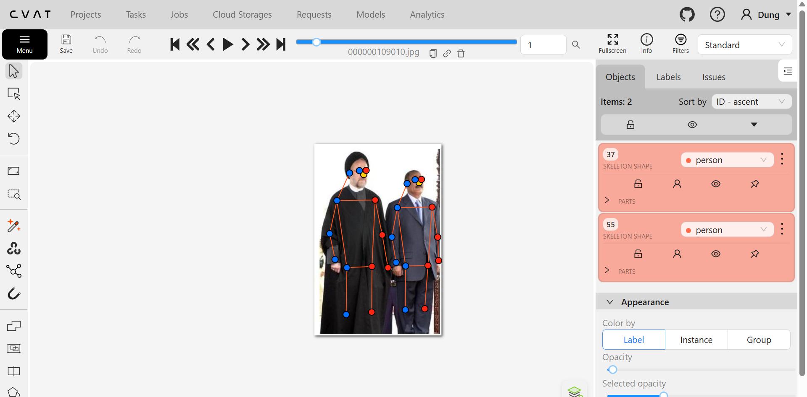
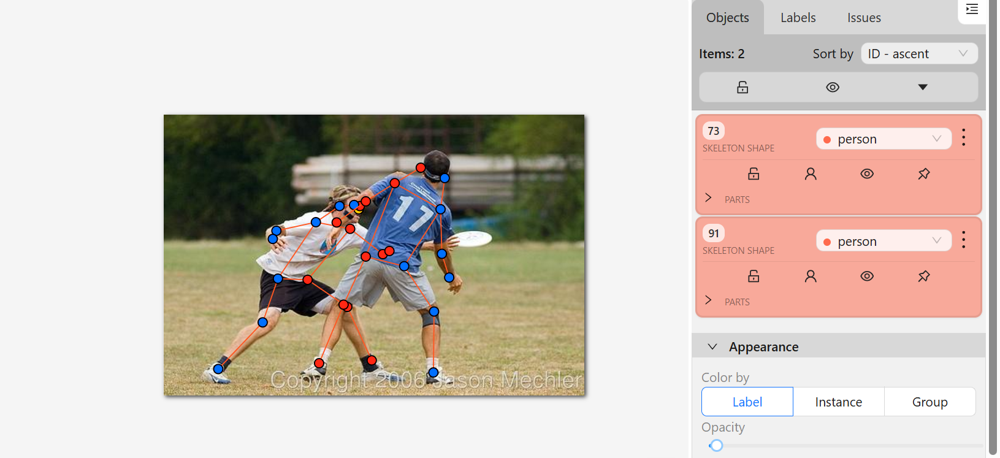
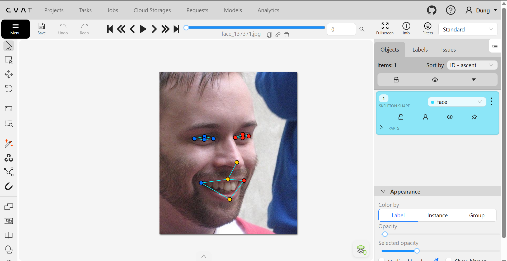
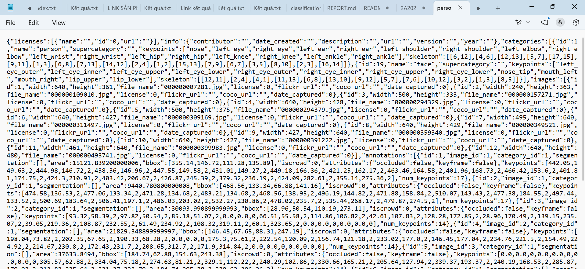

# Báo cáo cá nhân — LeNgocDung-2A202603103

Dữ liệu: 12 ảnh người COCO val2017 (Lin et al., 2014) và 8 ảnh chân dung Wikimedia Commons, chỉ dùng trong lớp.

## 0. Thông tin học viên

- Họ tên: Lê Ngọc Dung
- MSSV: 2A202603103
- Email: bachdungbiu3010@gmail.com
- Link repository: https://github.com/bachdungbiu3010-art/K5-L2-DAY04-LeNgocDung-2A202603103-KeypointPose
- Phiên bản CVAT (Help → About): v2.82.0 (cài bằng `git clone --branch v2.82.0`)
- Bộ ảnh (`src/exports/assignment.json` do `lab.py setup` tạo): có (12 ảnh người, 8 ảnh mặt)
- Giờ bắt đầu: 17h
- Giờ kết thúc: 20h

## 1. Kiểm tra label (CP0)

| Label | Kiểu | Số điểm | Tên điểm đúng bảng của lab? | Đúng thứ tự? | Số cạnh |
|---|---|---:|---|---|---:|
| `person` | skeleton | 17 | Có | Có | 19 |
| `face` | skeleton | 13 | Có | Có | 13 |

Mẫu `person` dựng theo người quay mặt về camera (các điểm `left_*` nằm bên phải khung mẫu)? Có

Cách đổi cờ `occluded` / `outside` cho **một điểm** trên phiên bản CVAT này (một câu):

Rê chuột vào đúng điểm cho sáng lên rồi bấm `Q` để thành `occluded` (`v = 1`) hoặc `O` để thành `outside` (`v = 0`); chuột phải vào điểm cũng mở menu có các nút này.

> Kiểm lại trên CVAT của mình trước khi giữ các câu trả lời mục 1.

## 2. Số lượng đã gán và thời gian (CP1, CP2)

Số skeleton theo file xuất `src/exports/`.

| Nhóm ảnh | Số ảnh | Số skeleton đã gán | Số người dưới 60 px (không gán) | Số poster / gương / màn hình bỏ qua | Thời gian (phút) |
|---|---:|---:|---:|---:|---:|
| `easy` | 5 | 5 | 0 | 0 | 10 |
| `occluded` | 3 | 6 | 0 | 0 | 5 |
| `back` | 2 | 4 | 0 | 0 | 5 |
| `small` | 1 | 2 | 1 (cao 41 px) | 0 | 7 |
| `crowd` | 1 | 3 | 0 | 0 | 6 |
| `faces` | 8 | 8 | — | 0 | 3 |

- Số ảnh người đã xong ở mốc phút 105: 6 / 10
- Thời gian thực tế (phút): CP1 20 · CP2 40 · CP3 15
- Ảnh tốn thời gian nhất là ảnh nào, vì sao?

000000309169.jpg: ảnh 3 người và có 2 phụ nữ đang va vào nhau, tay người áo đen bị khuất bởi cơ thể người áo vàng khiến việc đánh khuỷu tay và cổ tay trở nên khó khăn.

## 3. Bảng ca khó (CP1, CP2)

| Ảnh | Người / mặt | Điểm | Cờ đã chọn | Phân vân giữa | Lý do chọn |
|---|---|---|---:|---|---|
| face_405456 | mặt | 8 điểm mắt | 1 | 1 hay 0 | Bị che bởi cặp kính đen khó định vị |
| face_560526 | mặt | 8 điểm mắt | 0 | 1 hay 0 | Mũ che kín khó xác định vị trí |
| 000000359340 | người 1 | left_wrist | 1 | 1 hay 0 | tay khuất sau lưng nhưng đoán được vị trí nên để 1 |

## 4. Bảng tự review (CP3)

| Ảnh | Người / mặt | Điểm | Mã lỗi | Ghi chú | Đã sửa? |
|---|---|---|---|---|---|
| | | | | | |
| | | | | | |
| | | | | | |
| | | | | | |
| | | | | | |
| | | | | | |
| | | | | | |
| | | | | | |

| Ảnh | Người / mặt | Điểm | Thay đổi |
|---|---|---|---|
| 000000309169 (crowd) | người 2 | left_elbow, left_wrist | dời 35 px, 47 px |
| 000000309169 (crowd) | người 2 | right_ear, right_wrist | dời 3 px |
| 000000309169 (crowd) | người 3 | right_shoulder, right_elbow, right_wrist | cờ 2 → 0 |
| 000000359340 (back) | người 1 | right_wrist | cờ 2 → 0 |
| 000000391222 (back) | người 2 | right_hip | cờ 2 → 1 |
| face_560526 (mũ) | mặt | 8 điểm mắt | cờ 2 → 0 |
| face_560526 (mũ) | mặt | nose_tip, lip_upper, lip_lower | dời 3–7 px |
| face_449454 (nghiêng) | mặt | 4 điểm miệng | dời 11–33 px |
| face_137371 (nghiêng) | mặt | lip_upper | dời 10 px |
| face_405456 (kính râm) | mặt | 8 điểm mắt | cờ 1 → 0 |

Tổng hợp số lỗi theo mã:

| `lr_swap` | `vis_flag` | `position` | `missing` | `extra` | `ok` |
|---:|---:|---:|---:|---:|---:|
| 0 | 2 | 4 | 0 | 0 | 2 |

Điểm còn phân vân giữa `v = 1` và `v = 0`:

Ảnh `face_405456.jpg`, 8 điểm mắt (kính râm tối). Nếu chọn v = 1: guideline (dòng 111) quy định kính râm tối để `occluded`, đặt điểm sau tròng kính theo gọng. Nếu chọn v = 0: đeo kính khó chọn mắt được.

## 5. Kiểm file xuất và kết quả tự kiểm (CP4)

Tự kiểm tay trong file JSON:

| File | Người / mặt kiểm (ảnh, thứ tự) | Số phần tử `keypoints` | Điểm `outside` ra `v = 0`, `occluded` ra `v = 1`? | `num_keypoints` khớp? |
|---|---|---:|---|---|
| `LeNgocDung_persons.zip` | 000000007281.jpg, người 1 | 51 | Có | Có (17) |
| `LeNgocDung_persons.zip` | toàn bộ 20 người (kiểm bằng script) | 51 | Có — cờ chỉ gồm 0 / 1 / 2 (42 điểm `v = 0`, 10 điểm `v = 1`) | Có |
| `LeNgocDung_faces.zip` | toàn bộ 8 mặt (kiểm bằng script) | 39 | Có — cờ chỉ gồm 0 / 2 (16 điểm `v = 0`) | Có |

Sau khi xuất, CVAT ghi `occluded` thành `v = 1` và `outside` thành `v = 0`. Tọa độ của điểm `outside`: điểm máy bỏ ngay từ đầu nằm ở `0, 0`; điểm tôi tự chuyển sang `outside` trên CVAT vẫn giữ tọa độ cũ (4 điểm ở ảnh người, 16 điểm ở ảnh mặt). Khi huấn luyện, `v = 0` có trọng số 0 nên tọa độ này không được dùng.

Hai job đã chuyển sang completed trên CVAT? Đúng

Dán phần **TÓM TẮT** in ra từ `src/check_submission.py`:

----- TÓM TẮT (dán vào báo cáo mục 5) -----
- File person: LeNgocDung_persons.zip
  Số ảnh: 12 · số skeleton `person`: 20 · mỗi annotation 51 số
  Skeleton theo ảnh: 000000007281=2, 000000109010=2, 000000157271=2, 000000294329=1, 000000294379=1, 000000309169=3, 000000311497=2, 000000349521=1, 000000359340=2, 000000391222=2, 000000399983=1, 000000493741=1
  Cờ v: v=2 288 (85%) · v=1 10 (3%) · v=0 42 (12%)
  num_keypoints trung bình: 14.9
- File face: LeNgocDung_faces.zip
  Số ảnh: 8 · số skeleton `face`: 8 · mỗi annotation 39 số
  Skeleton theo ảnh: face_137371=1, face_141135=1, face_257657=1, face_300399=1, face_380754=1, face_405456=1, face_449454=1, face_560526=1
  Cờ v: v=2 88 (85%) · v=1 0 (0%) · v=0 16 (15%)
  num_keypoints trung bình: 11.0
- Ghi chú: 20 điểm v = 0 vẫn mang tọa độ cũ (CVAT 2.x xuất như vậy; chuẩn COCO ghi 0, 0). Không phải lỗi: điểm v = 0 bị bỏ qua khi huấn luyện và khi chấm.
- Số [LỖI]: 0 · số [CẢNH BÁO]: 2
Kết quả: ĐẠT (đọc lại từng cảnh báo ở trên)
___

## 6. Ảnh chụp màn hình

1. Label `person` trong label constructor (đủ 17 điểm có tên):

   

2. Một người quay lưng đã gán, cờ đã đặt:

   

3. Một khuôn mặt đã gán 13 điểm, phóng to vùng mắt:

   

4. Một đoạn JSON xuất của một người:

   

Nguồn ảnh: COCO val2017 / Wikimedia Commons.

## 7. Tự đánh giá

1. Lỗi bạn mắc nhiều nhất hôm nay, và cách bạn sẽ tránh ở dự án thật:

   Đánh nhanh vào những điểm chưa xác định rõ và mang tính ước chừng.

2. Một quy tắc bạn đề xuất thêm vào guideline (kèm ảnh ví dụ nếu có):

   Với những phần che phủ nào sẽ xử lý là V1 hay V0.

3. Nhãn của bạn đi vào model ở đâu? Chọn một lỗi bạn đã sửa và nói nó sẽ làm model học sai thế nào (heatmap, trọng số trong loss, hay bước lật ảnh):

   309169 người 2: khuỷu tay, cổ tay dời 35–47 px (`position`). Heatmap: đỉnh lệch 35–47 px, model học sai vị trí khớp tay khi người đứng chen nhau.

   face_560526: mắt bị mũ che mà máy để v = 2 (`vis_flag`). Trọng số loss: model bị bắt học vị trí mắt "nhìn thấy" ở chỗ thực ra là mũ len.

## 8. Khó khăn và lỗi kỹ thuật

- Máy chưa có CVAT local từ Ngày 2. Docker Desktop báo **"WSL not installed"**, phải chạy `wsl --install`, khởi động lại máy, rồi cài CVAT v2.82.0 bằng `docker compose`.
- Lần đăng nhập CVAT local đầu tiên dùng nhầm tài khoản CVAT online → báo "Unable to login"; đăng nhập lại bằng tài khoản tạo bằng `createsuperuser`.
- Máy chưa có Git: `git clone` báo lỗi, tải repo dạng ZIP rồi cài Git bằng `winget install Git.Git`.

## 9. Tài liệu tham khảo và công cụ AI đã dùng

- `docs/GUIDELINE.md`, `docs/CVAT_CHEATSHEET.md`, `docs/COCO_KEYPOINTS.md` của đề.
- **Claude (Anthropic):** hướng dẫn cài WSL, Docker, CVAT local; viết script gán nháp `tools/prelabel_pose.py`; soạn khung báo cáo này và chuyển bản Word sang Markdown; lập bằng script danh sách điểm đã sửa so với bản máy (mục 0b, mục 4) và kiểm file xuất (mục 5). Mục 3, 4, 7 tôi tự điền, nhưng có dùng ví dụ và mẫu câu Claude đưa khi hướng dẫn: dòng `000000359340` ở mục 3, đoạn "phân vân" ở mục 4 và câu 3 của mục 7.
- **YOLO11x-pose (Ultralytics)** và **dlib shape predictor 68 điểm** (gói `face_recognition_models`): sinh bản gán nháp, theo ghi chú cho phép của Thầy (xem mục 0b).
